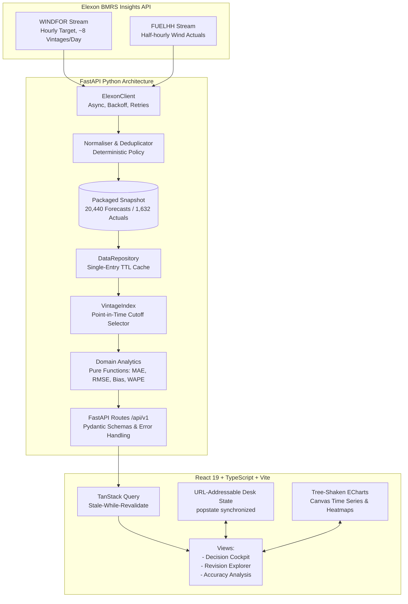

# Wind Desk

> **Auditable wind forecast intelligence and decision-replay workspace for UK day-ahead power procurement.**

Wind Desk empowers a UK electricity utility's power procurement team to quantitatively assess the accuracy of national wind generation forecasts available at the exact point-in-time when day-ahead purchasing decisions were made.

---

## 1. Product Overview

In the UK wholesale power market, utilities purchase electricity day-ahead to balance customer demand against generation from intermittent renewable sources such as wind. Day-ahead procurement decisions must be committed one day prior to physical delivery.

Wind Desk answers the core procurement question:
> **"What national wind generation forecast was actually available when we committed our purchasing decision, and how accurate was it against subsequent delivery?"**

### Workspaces
1. **Decision Cockpit**: Main landing replay view. Select any January 2026 decision date and configurable cutoff time (default: 15:30 Europe/London D−1) to evaluate the eligible forecast profile, actual generation (FUELHH), error series, headline metrics (MAE, RMSE, Bias, WAPE), and interval provenance.
2. **Forecast Revision Explorer**: Retrospective inspection of all WINDFOR vintages published for a delivery day. Clearly flags post-cutoff revisions as ineligible to eliminate look-ahead bias while visualizing forecast evolution over time.
3. **Accuracy & Risk Analysis**: Portfolio-wide monthly analytics across all January 2026 decisions, including daily MAE/bias trends, error distributions (P05/Median/P95), delivery-day vs. settlement-period error heatmap, largest forecast misses, and raw CSV data export.

---

## 2. Architecture & Data Flow



---

## 3. Directory Guide

```text
├── backend/
│   ├── app/
│   │   ├── api/          # FastAPI router, error mapping, dependencies
│   │   ├── domain/       # Pure models, point-in-time vintage index, metrics
│   │   ├── schemas/      # Pydantic v2 API request/response specifications
│   │   ├── services/     # Elexon HTTP client, deduplication, repo, reporting
│   │   ├── config.py     # Centralized settings & decision timing defaults
│   │   └── main.py       # FastAPI application factory, CORS, static SPA serving
│   ├── scripts/          # refresh_data.py (live upstream refresh & manifest generator)
│   ├── tests/            # pytest suite (65 tests, 100% passing)
│   ├── pyproject.toml    # Ruff & Mypy strict configuration
│   └── requirements.txt  # Production Python dependencies
├── frontend/
│   ├── src/
│   │   ├── api/          # Typed client & TanStack Query hooks
│   │   ├── components/   # MetricCard, EChart, IntervalInspector, ProvenanceBadge
│   │   ├── lib/          # Pure date arithmetic, formatters, chart options
│   │   ├── state/        # URL-synchronized desk state management
│   │   └── views/        # DecisionCockpit, RevisionExplorer, AccuracyAnalysis
│   ├── package.json      # Vite, React 19, TypeScript 5, ECharts, Vitest
│   └── vite.config.ts    # Dev proxy and Vitest configuration
├── data/snapshot/        # Reproducible real Elexon dataset (Jan 2026 decision period)
│   ├── manifest.json     # Provenance, query params, record counts, sha256
│   ├── raw/              # Compressed raw responses (windfor.json.gz, fuelhh_wind.json.gz)
│   └── normalized/       # Auditable normalized CSV files
├── docs/                 # Methodology, assumptions, video script
├── main.py               # Root FastAPI entrypoint for Vercel & local execution
├── index.py              # Root entrypoint alias
├── build.py              # Vercel deployment build hook (compiles Vite frontend)
├── vercel.json           # Vercel configuration (FastAPI runtime, build hooks, bundle inclusion, rewrites)
├── Procfile              # Heroku deployment entrypoint
├── Dockerfile            # Multi-stage production container (Node 22 + Python 3.12-slim)
├── docker-compose.yml    # Single-command local container environment
├── pyproject.toml        # Root project, Vercel build script, Ruff, Mypy & pytest config
├── requirements.txt      # Root production Python dependencies for Vercel runtime
└── README.md
```

---

## 4. Local Setup & Execution

### Prerequisites
- Python 3.12+ (or 3.14)
- Node.js 20+ & npm
- Docker (optional for containerized deployment)

### Option A: Local Development Setup
1. **Backend**:
   ```bash
   cd backend
   python -m venv .venv
   # Windows:
   .\.venv\Scripts\activate
   # Linux/macOS:
   source .venv/bin/activate

   pip install -r requirements-dev.txt
   uvicorn app.main:app --reload --port 8000
   ```
2. **Frontend**:
   ```bash
   cd frontend
   npm install
   npm run dev
   ```
   Open `http://localhost:5173` in your browser.

### Option B: Docker Compose
```bash
docker compose up --build
```
Open `http://localhost:8000` (FastAPI serves both the API and the pre-built React SPA from a single origin).

### Option C: Vercel Deployment (Hobby Tier, Zero-Cost)

The repository is configured for serverless deployment on Vercel's **Hobby Plan** ($0/month) with zero runtime fees:
- **Architecture**: A single unified deployment running FastAPI on Vercel Functions (Fluid Compute) while serving the pre-compiled React 19 SPA from the exact same origin (eliminating CORS issues and dual-domain drift).
- **Automated Frontend Build**: Vercel executes `python build.py` during deployment, which runs `npm ci` and `npm run build` inside `frontend/` to generate production artifacts in `frontend/dist`.
- **Packaged Snapshot Assets**: `vercel.json` uses `functions.includeFiles` to package `data/snapshot/**` (~1.27 MB) and `frontend/dist/**` (~1.3 MB) into the function bundle (well below the 500 MB uncompressed serverless limit).
- **Single-Origin Routing**: `vercel.json` routes both API endpoints (`/api/(.*)`) and frontend navigation (`/(.*)`) to the FastAPI root entrypoint (`main.py`), with static asset requests (`/assets/*`) promoted directly to Vercel's global CDN edge.

#### Step-by-Step Vercel Dashboard Setup
1. Push your changes to your GitHub fork/repository (`https://github.com/MJenius/GridBricks-Assignment`).
2. Log into the [Vercel Dashboard](https://vercel.com/) and click **"Add New..." > "Project"**.
3. Select your `GridBricks-Assignment` repository and click **Import**.
4. In **Project Settings**:
   - **Framework Preset**: Select **FastAPI** (or leave as auto-detected).
   - **Root Directory**: `./` (leave default repository root).
   - **Build Command**: Leave default or toggle override to `python build.py` (defined in `vercel.json` and `pyproject.toml`).
   - **Output Directory**: Leave default / empty (FastAPI runs dynamically as a Vercel Function).
   - **Install Command**: Leave default (`pip install -r requirements.txt`).
5. In **Environment Variables**, configure the following variables (all have sensible production defaults):

| Variable | Recommended Value | Description |
| :--- | :--- | :--- |
| `DATA_SOURCE` | `snapshot` | Default. Uses the packaged, verified January 2026 Elexon dataset (zero latency, deterministic, no external API rate limits). |
| `DECISION_CUTOFF_LOCAL` | `15:30` | Default illustrative decision cutoff time (`HH:MM` Europe/London wall-clock time). |
| `DECISION_LEAD_DAYS` | `1` | Default calendar days between decision date and delivery date (UK day-ahead = 1). |
| `SNAPSHOT_DIR` | `data/snapshot` | Filesystem path to the packaged snapshot directory (automatically resolved). |
| `STATIC_DIR` | `frontend/dist` | Filesystem path to the compiled React SPA distribution (automatically resolved). |
| `LOG_LEVEL` | `INFO` | Logging verbosity (`INFO`, `WARNING`, `DEBUG`). |
| `CORS_ORIGINS` | `""` | Optional CORS allowlist. Not required for same-origin Vercel deployments. |

6. Click **Deploy**. Vercel will install Python dependencies, execute `build.py` to compile the Vite frontend, bundle the snapshot dataset, and launch the application.
7. Both the web workspace (`https://<project-name>.vercel.app/`) and the API (`https://<project-name>.vercel.app/api/v1/health`) will be accessible under the single platform domain.

---

## 5. Elexon Endpoints & Data Provenance

All data is ingested strictly from official Elexon Insights Solution (BMRS) endpoints:
- **Actuals (FUELHH)**: `https://data.elexon.co.uk/bmrs/api/v1/datasets/FUELHH/stream?fuelType=WIND` (Resolution: 30 minutes, indexed by settlement date and settlement periods 1–48/50).
- **Forecasts (WINDFOR)**: `https://data.elexon.co.uk/bmrs/api/v1/datasets/WINDFOR/stream?publishDateTimeFrom=...` (Resolution: 60 minutes, national aggregated wind generation forecast).

### Temporal Resolution & Scoring Alignment
- **Evaluation Grid**: WINDFOR forecasts are published for hourly delivery horizons, while FUELHH provides settlement actuals every 30 minutes. Scoring and error metrics are evaluated strictly on matching hourly target intervals where WINDFOR and FUELHH (:00 half-hour start) coincide (24 evaluated intervals per day, 744 matched intervals across January).
- **Transparency**: The Decision Cockpit displays the complete 48-point half-hourly actual curve alongside the hourly forecast, with intervals and CSV explicitly disclosing the evaluated hourly resolution without synthesizing or averaging intermediate 30-minute forecast values.

### Decision Scope vs. Delivery Scope vs. Snapshot Retrieval Range
Under a standard day-ahead purchasing cycle with a 1-day lead time (`lead_days = 1`):
- **Decision Window**: January 1, 2026 to January 31, 2026 (31 decision dates).
- **Evaluated Delivery Window**: January 2, 2026 to February 1, 2026 (31 delivery days, 744 hourly intervals).
- **Snapshot Retrieval Range**: The packaged raw snapshot covers a wider window to ensure full retrospective capability:
  - *WINDFOR publication range*: December 30, 2025 00:00 UTC to February 3, 2026 00:00 UTC (20,440 records across 280 vintages, capturing forecasts published up to 3 days prior to the first January decision, as well as post-delivery revisions).
  - *FUELHH settlement range*: January 1, 2026 to February 3, 2026 (1,632 half-hourly actual records).
- Run `python -m scripts.refresh_data` inside `backend/` to re-fetch live data and refresh the manifest.

---

## 6. Point-in-Time Forecast Selection Algorithm

For target delivery interval $t$ and decision cutoff time $c$:
$$\text{selected\_forecast}(t, c) = \text{forecast}(t, \max(\text{publishTime} \le c))$$

- **Look-Ahead Bias Protection**: Forecasts published strictly after $c$ are never selected for decision replay.
- **Publication at Cutoff**: Records with $\text{publishTime} = c$ are eligible.
- **Deterministic Deduplication**: Conflicting duplicates for the same $(t, \text{publishTime})$ key are excluded and logged in the data quality manifest rather than silently averaged.

---

## 7. Metrics & Sign Conventions

$$\text{Error}_{\text{MW}} = \text{Forecast}_{\text{MW}} - \text{Actual}_{\text{MW}}$$
- **Positive Error ($>0$)**: Over-forecast (excess wind forecasted; power procured in excess).
- **Negative Error ($<0$)**: Under-forecast (wind shortfall; need to procure balance).

Headline metrics computed only over matched, valid interval pairs:
- **MAE** (Mean Absolute Error, MW): $\frac{1}{n} \sum |e_i|$
- **RMSE** (Root Mean Squared Error, MW): $\sqrt{\frac{1}{n} \sum e_i^2}$
- **Mean Bias** (MW): $\frac{1}{n} \sum e_i$
- **WAPE** (%): $100 \times \frac{\sum |e_i|}{\sum \text{Actual}_i}$

---

## 8. Testing & Quality Verification

Run all test suites locally:

```bash
# Backend pytest (65 unit, API, and look-ahead bias regression tests)
cd backend
pytest -v

# Backend linting & type checks
ruff check .
mypy

# Frontend tests & build
cd ../frontend
npm test
npm run build
```

---

## 9. Disclosure of AI Tooling

In accordance with hiring instructions:
- **Tooling Used**: Google Antigravity paired with Claude Opus 5.5 and Gemini 3.8 Flash.
- **Role**: AI was utilized to draft initial boilerplate, conduct API probe queries against Elexon, build regression test cases, and refine TypeScript interfaces. All architectural decisions, mathematical formulas, duplicate resolution policies, and test results were deterministically executed and verified.
